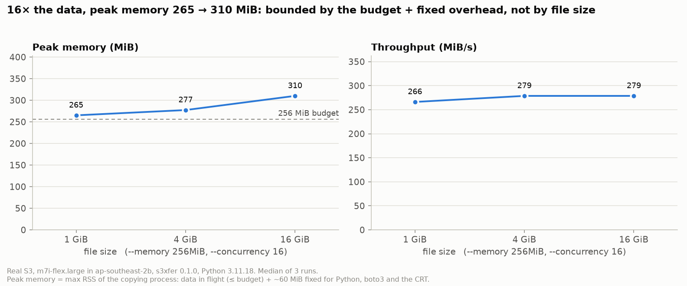
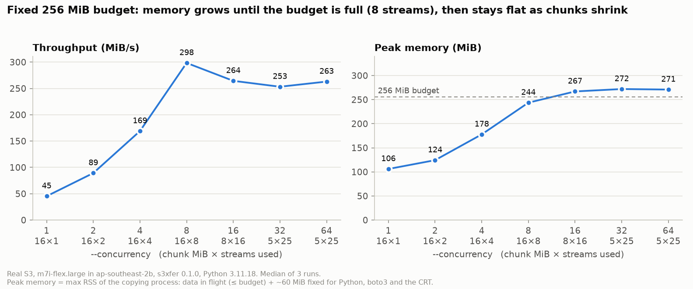

# s3xfer

Stream and copy S3 objects of **any size in constant memory**.

A naive S3 copy reads the whole object into memory, so a 10 GB file needs 10+ GB of RAM and a worker with a fixed memory limit gets OOM-killed. `s3xfer` keeps memory flat: you give it a budget, and file size only changes how many chunks it moves, never how much it holds at once.


## What's inside

s3xfer is built by composition: each concern is one small object, and you hand a `Copier` the pieces it should use.

| Piece | What it does |
| --- | --- |
| `Copier(source, dest, config=, retry=, events=)` | S3 → S3 copy with parallel range GETs and multipart upload. Reads go through `source`, writes through `dest` (different clients = different credentials). Parts finish in any order, and `CompleteMultipartUpload` joins them by part number. A failure aborts the upload, so nothing is left half-done. |
| `Syncer(copier, force=)` | Copies every object under a prefix, one object at a time with the copier's settings, so the memory budget covers the whole sync. Skips objects the destination already has with the same size and a newer-or-equal `LastModified`, like `aws s3 sync`. |
| `TransferConfig(memory_budget, concurrency, max_chunk)` | The memory budget and parallelism; turns a file size into a chunk size and stream count that respect S3's limits (see the rule below). |
| `RetryPolicy(max_attempts, backoff)` | Per-call retries with exponential backoff. |
| `TransferEvents` | What a run reports: `start`, `file_started`, `advance(nbytes)`, `warning`, `finished`. Implement it for your own logging or metrics; `NullEvents` (the default) reports nothing, and the CLI's `TerminalEvents` draws the progress bar. |
| `S3Path`, `TransferItem` | Plain data: a bucket + key, and one object to move. |
| `S3RangeStream` | A seekable, read-only file object over S3. `seek()` moves a cursor, and `read()` issues a Range GET with a small read-ahead buffer. Pass it to `zipfile`, `openpyxl`, `csv` or `pandas` and only the bytes they ask for are downloaded. |
| `s3_copy()`, `s3_sync()` | Function shortcuts that build a `Copier` / `Syncer` for you. |

Modules are layered (`paths`, `plan`, `retry` → `events`, `progress` → `copy` → `sync` → `cli`), and a test fails on any import that points upward or forms a cycle.

## The rule

The memory budget is shared between the parallel streams. More concurrency means smaller chunks, not more memory:

```
chunk_size  = budget / (concurrency × 2)        (2 = response buffer + upload copy)
              clamped to [5 MiB, 16 MiB]         (S3's minimum part / a retry-friendly maximum)
concurrency = what you ask for, reduced only if even 5 MiB chunks don't fit the budget
peak memory ≈ concurrency × chunk_size × 2  ≤  budget
num_chunks  = ceil(file_size / chunk_size)      ← the only thing file size affects
```

| `--memory` | `--concurrency` | chunk | streams | peak |
| --- | --- | --- | --- | --- |
| 256MiB | 8 | 16 MiB | 8 | 256 MiB |
| 256MiB | 16 | 8 MiB | 16 | 256 MiB |
| 256MiB | 32 | 5 MiB | 25 | 250 MiB |
| 2GiB | 8 | 16 MiB | 8 | 256 MiB (chunks don't grow past 16 MiB) |
| 2GiB | 8, `--max-chunk 1GiB` | 128 MiB | 8 | 2 GiB (prints a warning) |

Chunks only go above 16 MiB when S3's 10,000-part limit forces it (files over ~156 GiB), or when you raise the ceiling with `--max-chunk` (`max_chunk=` in Python). Doing that prints a warning, since bigger parts rarely add speed and each failed part retries more data. On top of the budget, expect ~60 MiB of fixed overhead for Python, boto3 and the CRT.

## Usage

```python
import boto3
from s3xfer import Copier, RetryPolicy, S3Path, Syncer, TransferConfig

src = boto3.Session(profile_name="account-a").client("s3")
dst = boto3.Session(profile_name="account-b").client("s3")

copier = Copier(src, dst,
                config=TransferConfig(memory_budget="512MiB", concurrency=16),
                retry=RetryPolicy(max_attempts=5))

# Copy a 50 GB object using at most ~512 MiB for data in flight
result = copier.copy(S3Path("src-bucket", "big.parquet"), S3Path("dst-bucket", "big.parquet"))
print(result.plan)   # TransferPlan(file_size=..., chunk_size=16777216, concurrency=16, num_parts=...)

# Copy a whole prefix with the same clients and settings
Syncer(copier).sync(S3Path("src-bucket", "data/2024"), S3Path("dst-bucket", "backup/2024"))
```

Report progress anywhere by passing an object with the `TransferEvents` methods:

```python
from s3xfer import NullEvents

class LogEvents(NullEvents):            # override only what you need
    def file_started(self, index, item):
        log.info("copying %s (%d bytes)", item.src, item.size)
    def advance(self, nbytes):          # called from worker threads
        metrics.increment("s3xfer.bytes", nbytes)

Copier(src, dst, events=LogEvents()).copy(...)
```

Read a zip's index from the end of a huge archive without downloading it:

```python
import zipfile
from s3xfer import S3RangeStream

with zipfile.ZipFile(S3RangeStream(src, "bucket", "archive.zip")) as z:
    print(z.namelist())
```

The function shortcuts do the same in one call:

```python
from s3xfer import s3_copy, s3_sync

s3_copy(src, "src-bucket", "big.parquet", "dst-bucket", "big.parquet",
        dst_client=dst, memory_budget="512MiB", concurrency=16)
s3_sync(src, "src-bucket", "data/2024", "dst-bucket", "backup/2024",
        on_plan=lambda todo, skipped: print(len(todo), "to copy"),
        progress=lambda nbytes: ...)   # called as each part finishes (from worker threads)
```

CLI:

```bash
s3xfer cp   s3://src-bucket/big.bin   s3://dst-bucket/big.bin   --memory 512MiB --concurrency 8
s3xfer sync s3://src-bucket/data/2024 s3://dst-bucket/backup/2024 --memory 512MiB

# Cross-account: read with one AWS profile, write with another
s3xfer cp s3://src-bucket/big.bin s3://dst-bucket/big.bin --src-profile account-a --dst-profile account-b
```

On a terminal, both commands show a live progress bar (percent, bytes, speed, ETA, current file). When output is redirected they print one line per file instead. Use `-q` to silence it, and `sync --force` to copy everything even if it's already up to date.

A prefix is treated as a folder: `s3://b/data` matches `data/...` but not `data2/...`. `s3://b` alone means the whole bucket.

Without `--dst-profile`, the destination uses the same credentials as the source. Without `--src-profile`, the source uses boto3's default credential chain.

## Real-S3 benchmarks

Measured on an `m7i-flex.large` in `ap-southeast-2`, copying within one bucket; median of 3 runs. Reproduce with `bench/bench_real_s3.py` (see its docstring) and `bench/plot_real_s3.py`. Raw numbers: [`bench/real_s3_results.csv`](bench/real_s3_results.csv).

**Memory doesn't depend on file size.** 1, 4 and 16 GiB objects at `--memory 256MiB --concurrency 16` peak at 324, 325 and 330 MiB (the budget plus ~60 MiB fixed for Python, boto3 and the CRT).



**Concurrency is bounded by the budget.** Up to 8 streams, 16 MiB chunks fit, so memory grows with each stream. Past that, chunks shrink to keep memory at the budget. Throughput peaks at 16 streams (8 MiB chunks, 378 MiB/s); at 32+ the planner hits S3's 5 MiB part minimum and caps at 25 streams, which is slower.



**Chunk size trades a little speed for a lot of memory.** At 16 streams, 8 MiB chunks are 8% slower than 16 MiB and use 44% less memory; 5 MiB chunks cost 25%.


## Development

```bash
pip install -e ".[dev]"
pytest                          # 76 tests against moto (fake S3, no AWS account needed)
pip install -e ".[bench]"
python bench/bench_memory.py    # memory benchmark → bench/results.csv
python bench/plot.py            # redraw bench/memory_vs_filesize.png
python bench/bench_real_s3.py --bucket <bucket> --region <region>   # real S3 (run on EC2 near the bucket)
python bench/plot_real_s3.py    # redraw the bench/real_s3_*.png charts
```

## Roadmap

- [ ] Async backend (aioboto3)
- [x] Real-S3 benchmarks: throughput and memory vs concurrency, chunk size and file size
- [ ] Cost per GB (request + transfer pricing)
- [ ] Resume interrupted copies from completed parts
- [ ] Server-side `UploadPartCopy` fast path when one set of credentials can read both buckets

## License

MIT
